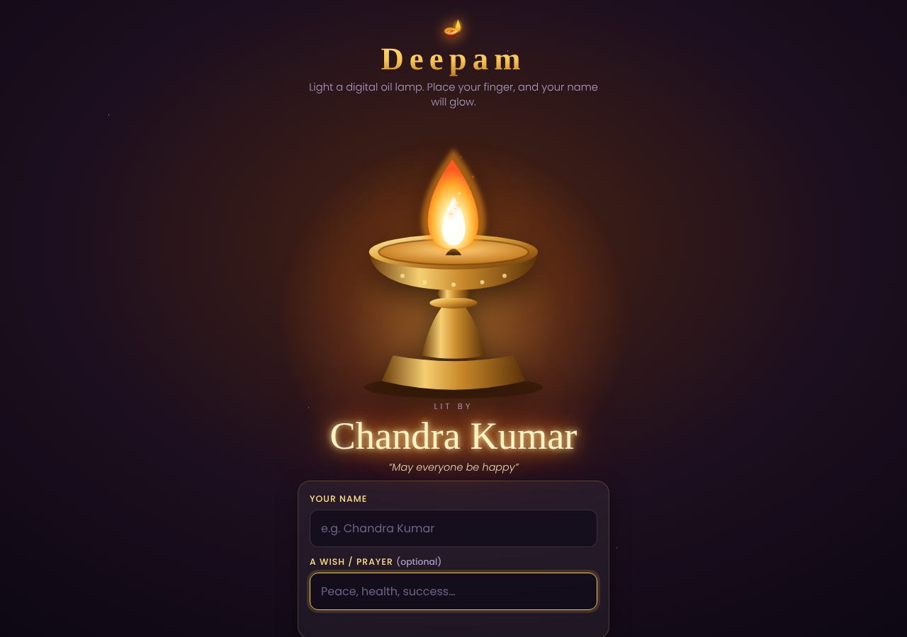
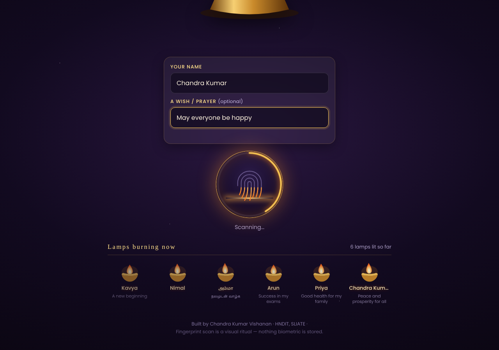
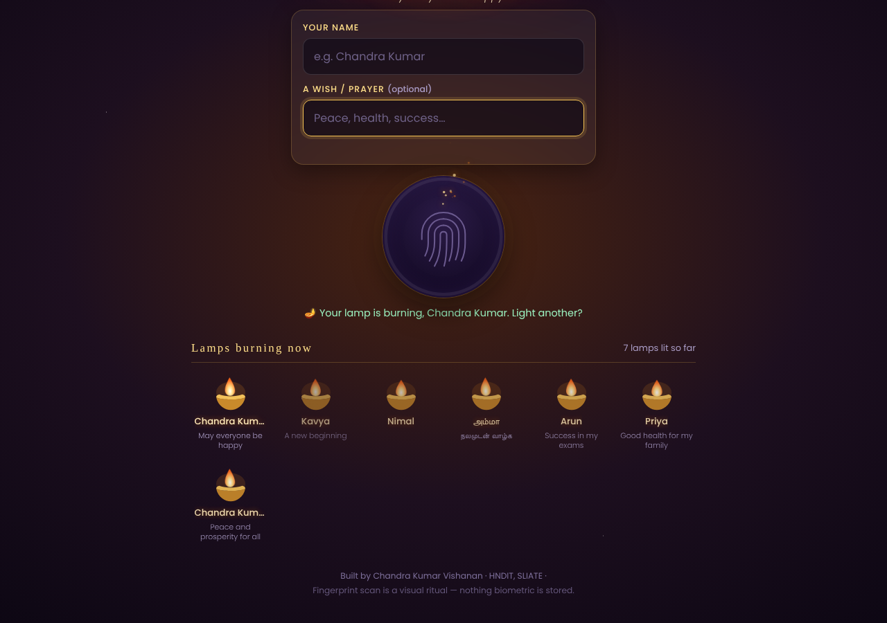
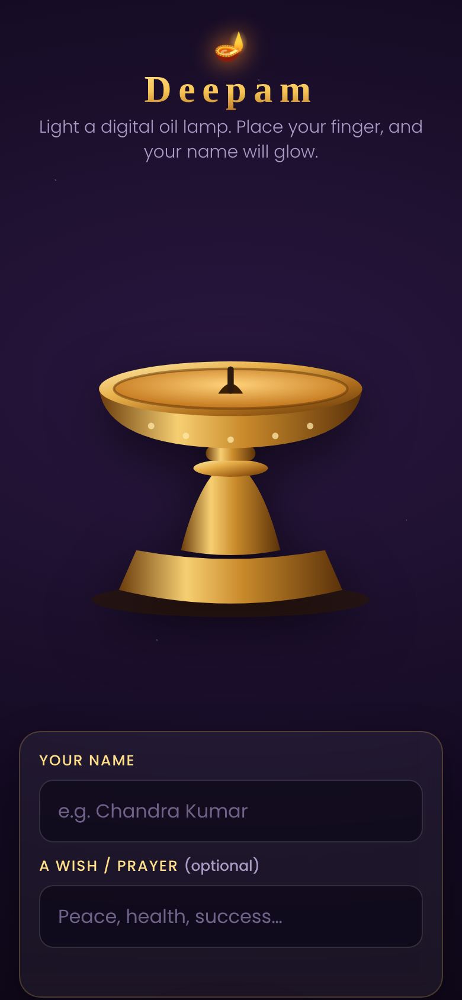

# 🪔 Deepam – Digital Oil Lamp

Press & hold the fingerprint → the brass lamp ignites → **your name glows** in golden light.

   

Built by **Chandra Kumar Vishanan** · HND in Information Technology (HNDIT) – SLIATE

## ✨ Features
- Brass oil lamp drawn in SVG with a real flickering flame, glow halo and rising embers (canvas)
- **Fingerprint scanner**: hold ~2.2 s – progress ring, scan line, ridges light up; release early and it cancels
- Name (+ optional wish) appears under the lamp with a glowing script effect; Unicode names are also supported
- **Wall of lamps**: everyone's lamps burn together and refresh live; older lamps slowly dim (24 h life)
- Ignition sound (Web Audio) and phone vibration; works with mouse, touch and keyboard (Space/Enter)
- Mobile-first, reduced-motion friendly
- **PHP backend**: PDO prepared statements, CSRF token, server-side name validation, hold-time check, rate limit (6 lamps/hour per visitor), XSS-safe output

> The scan is a visual ritual. Browsers cannot read raw fingerprints, and **no biometric data is captured or stored**.

## 🚀 Install (WAMP)
1. Copy to `C:\wamp64\www\digital_oil_lamp`
2. phpMyAdmin → Import `sql/database.sql`
3. Check `config/config.php` (root / empty password, port 3306 – use 3307 if needed)
4. Open `http://localhost/digital_oil_lamp/`

Tune `HOLD_MS`, `MAX_LAMPS_PER_HOUR` and `LAMP_LIFE_HOURS` in `config/config.php`. Fonts load from Google Fonts (internet needed; fallbacks are built in).

## 🖼️ Screens
| Scanning | Wall of lamps | Mobile |
|---|---|---|
|  |  |  |

## 🧪 Tested
Playwright UI test (`docs/ui_test.js`): empty name blocked, early release cancels, full hold lights lamp, name shown, XSS/markup rejected, CSRF and hold-time enforced server-side, no mobile overflow.

## 👤 Author
**Chandra Kumar Vishanan** — HNDIT, SLIATE · MIT License
